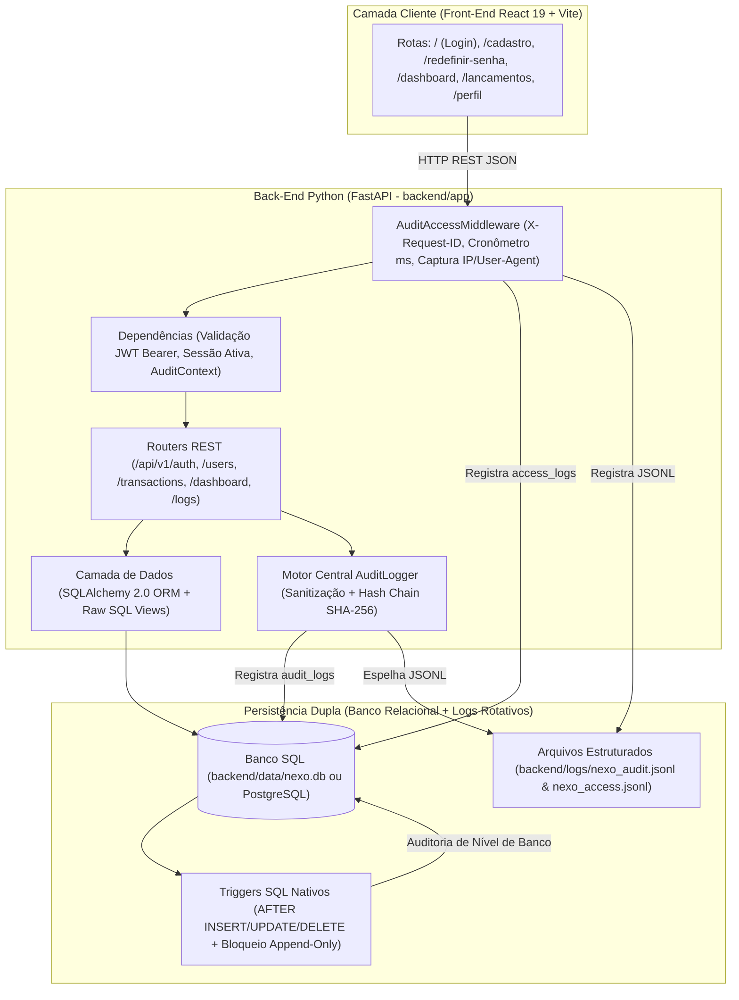

# Arquitetura de Back-End, Engenharia de Banco de Dados e Auditoria 360° — Projeto Nexo

Este documento detalha a arquitetura oficial do **Back-End (Python + FastAPI)**, a **Modelagem Física Relacional (SQL)** e o **Motor Híbrido de Auditoria Imutável (Python + Triggers SQL)** do **Projeto Nexo**.

---

## 1. Visão Macro da Arquitetura em Camadas

O Back-End foi projetado seguindo **Clean Layered Architecture**, separando responsabilidades de protocolo HTTP, segurança, regras de negócio, persistência relacional e auditoria pericial.



---

## 2. Estrutura de Diretórios do Back-End e Banco

```text
Project_Nexo/
├── backend/
│   ├── .env.example                        # Template de variáveis de ambiente
│   ├── requirements.txt                    # Dependências Python do servidor
│   ├── data/
│   │   ├── nexo.db                         # Banco SQLite inicializado automaticamente
│   │   └── backups/                        # Diretório reservado para backups
│   ├── logs/
│   │   ├── nexo_audit.jsonl                # Trilha de auditoria de negócio em JSON Lines
│   │   ├── nexo_access.jsonl               # Trilha de tráfego HTTP em JSON Lines
│   │   └── nexo_errors.log                 # Log de erros operacionais
│   ├── app/
│   │   ├── main.py                         # Aplicação FastAPI, Lifespan, CORS e Middlewares
│   │   ├── core/
│   │   │   ├── config.py                   # Configurações tipadas (Pydantic Settings)
│   │   │   ├── security.py                 # PBKDF2-HMAC-SHA256 (600k iterações), JWT (JTI) e Códigos
│   │   │   ├── audit_logger.py             # Motor 360° de Auditoria (SQL + JSONL + Sanitização)
│   │   │   └── exceptions.py               # Tratamento global de erros HTTP e validação
│   │   ├── db/
│   │   │   ├── session.py                  # Engine SQLAlchemy 2.0 (WAL + Foreign Keys ON)
│   │   │   ├── models/entities.py          # Modelos ORM mapeados 1:1 com os scripts SQL
│   │   │   └── scripts/
│   │   │       ├── init_db.py              # Orquestrador de DDL SQL + Seeds iniciais
│   │   │       └── inspect_logs.py         # Utilitário CLI para leitura de logs no terminal
│   │   ├── schemas/                        # Contratos Pydantic v2 (auth, user, transaction, audit)
│   │   └── api/
│   │       ├── deps.py                     # Autenticação JWT e extração de AuditContext
│   │       ├── middlewares/
│   │       │   └── audit_middleware.py     # Interceptador de 100% das chamadas HTTP
│   │       └── routers/                    # Endpoints REST (/auth, /users, /transactions, /dashboard, /logs)
│   └── tests/
│       └── test_nexo_api.py                # Suíte End-to-End automatizada (12 cenários)
└── database/
    ├── json_seeds/
    │   └── admin_seed.json                 # Seed inicial de Administrador e Lançamentos
    └── sql/
        ├── schema_usuarios.sql             # Tabelas usuarios, perfis_preferencias, sessoes_tokens, codigos_recuperacao
        ├── schema_projetos.sql             # Tabelas categorias_padrao e lancamentos + índices compostos
        ├── schema_relatorios.sql           # Tabela relatorios_exportados e Views analíticas
        ├── schema_logs.sql                 # Tabelas audit_logs, access_logs, Views e Triggers SQL
        └── schema_postgresql_prod.sql      # DDL otimizado para PostgreSQL em produção (UUID, JSONB, GIN)
```

---

## 3. Engenharia do Banco de Dados (SQL)

### 3.1 Tabelas Principais
1. **`usuarios`** ([`schema_usuarios.sql`](file:///c:/Users/ggnon/OneDrive/%C3%81rea%20de%20Trabalho/Nexo/Project_Nexo/database/sql/schema_usuarios.sql)):
   - Identidade central do usuário (`id` UUID, `nome`, `email` único, `senha_hash` PBKDF2-SHA256, `role` em `['user', 'admin', 'auditor']`, `ativo`, `termos_aceitos`, `ultimo_login_em`).
2. **`perfis_preferencias`** ([`schema_usuarios.sql`](file:///c:/Users/ggnon/OneDrive/%C3%81rea%20de%20Trabalho/Nexo/Project_Nexo/database/sql/schema_usuarios.sql)):
   - Relação `1:1` com `usuarios` (`ON DELETE CASCADE`). Armazena `telefone`, `data_nascimento`, `endereco`, `moeda_preferida` (`BRL`, `USD`, `EUR`, `GBP`) e `dois_fatores_ativo`.
3. **`sessoes_tokens`** e **`codigos_recuperacao`** ([`schema_usuarios.sql`](file:///c:/Users/ggnon/OneDrive/%C3%81rea%20de%20Trabalho/Nexo/Project_Nexo/database/sql/schema_usuarios.sql)):
   - Rastreamento individual de tokens JWT emitidos (`token_jti`) com suporte a revogação imediata no logout ou redefinição de senha, além dos códigos temporários de 6 dígitos para recuperação de conta.
4. **`categorias_padrao`** e **`lancamentos`** ([`schema_projetos.sql`](file:///c:/Users/ggnon/OneDrive/%C3%81rea%20de%20Trabalho/Nexo/Project_Nexo/database/sql/schema_projetos.sql)):
   - Armazena todas as Receitas (`income`) e Despesas (`expense`), com constraints `CHECK (valor > 0)`, `CHECK (tipo IN ('income', 'expense'))`, `CHECK (status IN ('confirmado', 'pendente'))` e índices compostos `(usuario_id, data_lancamento DESC)`.
5. **`relatorios_exportados`** e Views Analíticas ([`schema_relatorios.sql`](file:///c:/Users/ggnon/OneDrive/%C3%81rea%20de%20Trabalho/Nexo/Project_Nexo/database/sql/schema_relatorios.sql)):
   - `vw_resumo_mensal_usuario`: Calcula entradas, saídas e resultado líquido mensal por usuário diretamente em SQL.
   - `vw_despesas_por_categoria`: Agrupa despesas por categoria e mês.
6. **`audit_logs`** e **`access_logs`** ([`schema_logs.sql`](file:///c:/Users/ggnon/OneDrive/%C3%81rea%20de%20Trabalho/Nexo/Project_Nexo/database/sql/schema_logs.sql)):
   - Núcleo de rastreabilidade total do sistema.

---

## 4. Arquitetura do Sistema de Auditoria 360° (Python + SQL)

O sistema de logs foi desenhado para responder com precisão cirúrgica a **4 perguntas fundamentais** sobre qualquer evento no site:
1. **QUEM FEZ?** (`usuario_id`, `usuario_nome`, `usuario_email`, `ip_origem`, `user_agent`)
2. **QUANDO FEZ?** (`data_hora_local` no fuso de Brasília `-03:00` e `data_hora_utc` em UTC)
3. **O QUE FEZ?** (`acao`, `categoria_evento`, `resumo_humano` em português claro, `rota_http`, `metodo_http`)
4. **O QUE MUDOU?** (`dados_anteriores` em JSON com o estado exato *antes* da ação e `dados_novos` em JSON com o estado *depois* da ação)

### Garantias de Segurança dos Logs:
* **Dupla Captura (Python + SQL Triggers):** Mesmo que um administrador edite uma linha diretamente no banco de dados fora do site, os triggers `trg_audit_lancamentos_insert`, `trg_audit_lancamentos_update`, `trg_audit_lancamentos_delete` e `trg_audit_usuarios_update` disparam automaticamente gravando um registro com `origem_registro = 'SQL_TRIGGER'`.
* **Imutabilidade Garantida por Trigger (`Append-Only`):** Os triggers `trg_audit_logs_prevent_update` e `trg_audit_logs_prevent_delete` bloqueiam a nível de motor SQL qualquer tentativa de executar `UPDATE` ou `DELETE` na tabela `audit_logs`.
* **Encadeamento Criptográfico (`Hash Chain SHA-256`):** Cada log armazena o `hash_anterior` e calcula seu próprio `hash_integridade` SHA-256, garantindo prova pericial contra adulteração.
* **Sanitização Automática (`Zero Credential Leak`):** Senhas, hashes e códigos secretos são automaticamente mascarados como `"[REDACTED]"` antes de entrarem no banco ou nos arquivos `.jsonl`.
